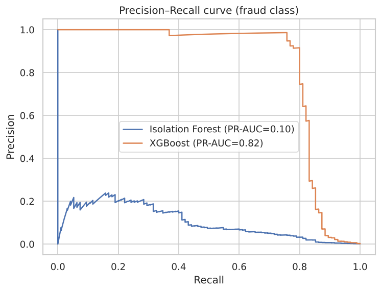
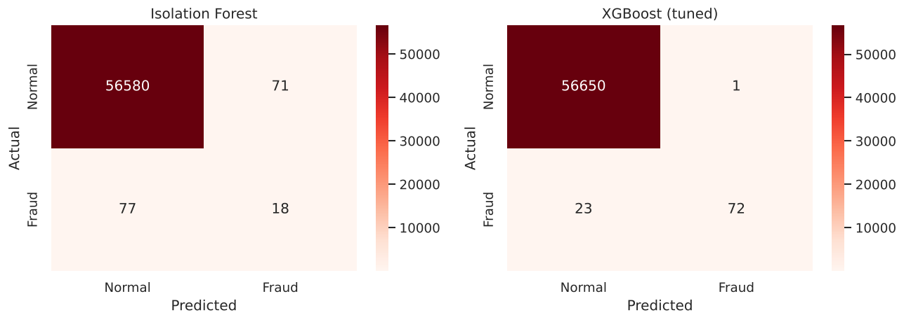

# 💳 Credit Card Fraud Detection — Unsupervised vs Supervised

Detects fraudulent card transactions where **only 0.17% of 284,807 transactions are fraud**. Compares an unsupervised anomaly detector (Isolation Forest) with a supervised, class-weighted XGBoost model.



## Results (test set: 56,746 transactions, 95 frauds)

| Model | Precision | Recall | F1 | PR-AUC | Frauds caught | False alarms |
|---|---|---|---|---|---|---|
| Isolation Forest (unsupervised) | 0.20 | 0.19 | 0.20 | 0.10 | 18 / 95 | 71 |
| XGBoost (threshold 0.5) | 0.89 | **0.80** | 0.84 | **0.82** | **76 / 95** | 9 |
| XGBoost (tuned threshold 0.90) | **0.99** | 0.76 | **0.86** | **0.82** | 72 / 95 | **1** |

> With 99.8% normal transactions, *accuracy is meaningless* (predicting "never fraud" scores 99.8%). Models are judged on **precision, recall and PR-AUC** for the fraud class.

## Approach

1. **Cleaning** – removed 1,081 duplicate transactions; stratified 80/20 split.
2. **Isolation Forest** – trained without labels, `contamination` set to the fraud rate. Useful when no labels exist, but many frauds don't look unusual overall.
3. **XGBoost** – `scale_pos_weight` ≈ 580 so a missed fraud costs far more than a missed normal transaction.
4. **Threshold tuning** – chosen on a validation split of the training data (never on the test set) to maximise F1.



## Takeaways

* Labels make a huge difference here: PR-AUC jumps from **0.10 to 0.82**.
* The tuned model flags only **1 normal transaction out of 56,651** while still catching 72 frauds.
* In production the two approaches complement each other: XGBoost for known fraud patterns, Isolation Forest as a safety net for new ones.
* The threshold is a business choice: lower it to catch more fraud in exchange for more verification SMS messages.

## Data

[Credit Card Fraud Detection – Kaggle (ULB)](https://www.kaggle.com/datasets/mlg-ulb/creditcardfraud). The CSV (~150 MB) exceeds GitHub's file limit, so it is not included. Download it and place it at `data/creditcard.csv`. Features `V1`–`V28` are anonymised PCA components.

## Run it

```bash
pip install -r requirements.txt
jupyter notebook credit_card_fraud_detection.ipynb
```

**Tech:** Python · pandas · scikit-learn · XGBoost · seaborn

---

## 👤 Author

**Reda Akram** — Computer Science (AI) student at the University of Technology, Baghdad. I build ML models, automation systems and AI agents.

GitHub: [@devb777r](https://github.com/devb777r)
